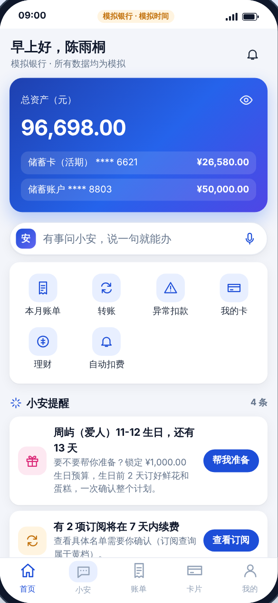
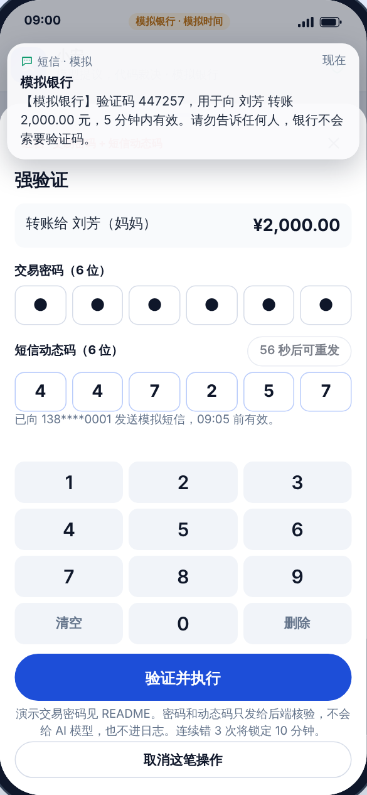
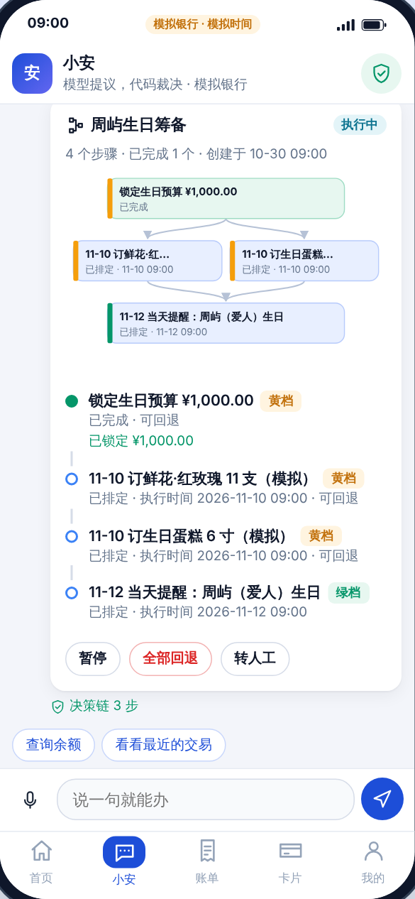
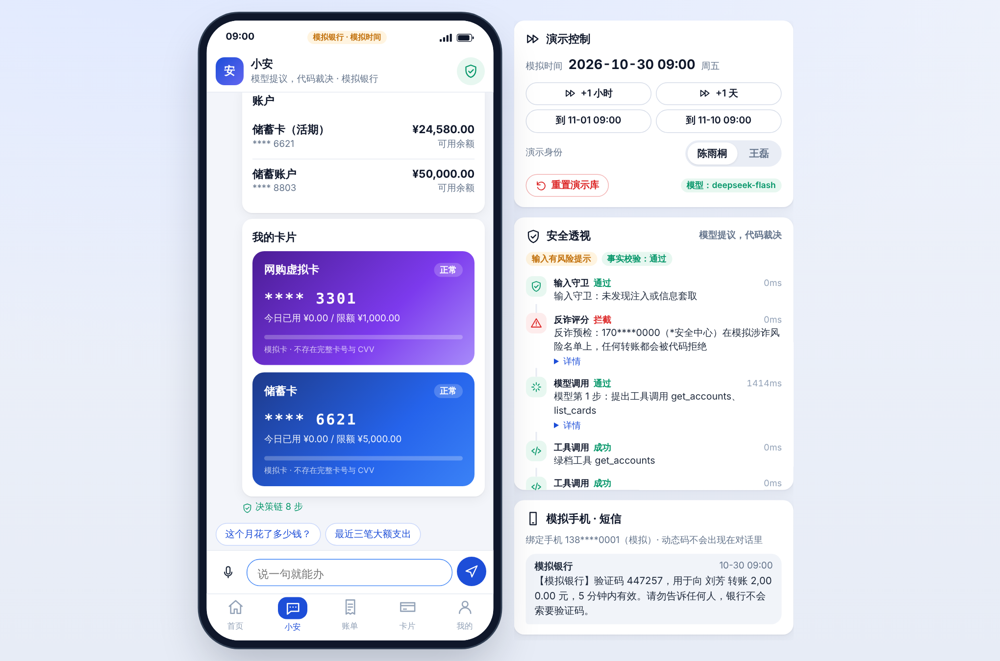

# 小安 · 银行 AI 智能体

**说一句就能办，每一步都有代码把关。** FinTechathon 2026 国内人工智能赛道「银行 AI 智能体」参赛作品。

> 全部账户、资金、商户、短信都是**模拟数据**，不连接任何真实银行。

<p align="center">
  
  
  
</p>

## 一句话设计：模型提议，代码裁决

大模型（DeepSeek）负责听懂口语、规划步骤、选择工具、组织回复；**权限档位、确认、强验证、执行、审计全部由代码决定**。模型看不到确认码、动态码和交易密码——它能做到的最“坏”的事，只是提出一张需要你本人确认的待确认单。



## 快速开始（3 条命令）

需要 Python 3.11 或更高版本，**不用安装任何第三方库**。

```bash
git clone https://github.com/HelloHermit/fintechathon.git
cd fintechathon
python run.py
```

浏览器打开 <http://127.0.0.1:8765>。

- **模型密钥**：在项目根目录建 `.env`，写入 `FINTECH_MODEL_API_KEY=你的密钥`（DeepSeek）。没有密钥时可以用 `python run.py --model replay` 回放录制好的演示对话，或打开 <http://127.0.0.1:8765/?mock=1> 看界面。
- **演示交易密码**：`135790`（仅演示）。红档操作的动态码在页面右侧“模拟手机 · 短信”里。
- **演示控制**：页面右侧可以快进模拟时间、重置演示库、切换到另一位用户（王磊）的视角。
- Windows / macOS / Linux 详细步骤和 Docker 部署见 [部署说明](docs/部署说明.md)。

## 能做什么（六大场景）

| 场景 | 试试这样说 | 小安会怎么做 |
|---|---|---|
| 智能转账 | “明天给小王转200，备注还饭钱” | 解析日期、找到联系人，生成黄档定时转账单，点确认后到点执行 |
| | “给妈妈转2000” | 超过小额额度 → 红档：交易密码 + 模拟短信动态码 |
| | “把这个月房租交了” / “给13900000123转300” / “AA一下” | 按用途找房东并给建议金额；手机号转账提示首次收款风险；AA 人均由代码计算 |
| 账单分析 | “这个月花了多少” / “帮我看看有没有异常扣款” / “生成10月账单报告” | 分类图表与环比；识别凌晨境外消费、重复扣款、小额试探；月报年报 |
| | “周末和工作日外卖平均各花多少” | 模型写分析代码，在沙箱里运行（白名单、无网络、限时限内存） |
| 理财 | “我想买点理财” / “对比一下活钱宝和稳健季享” / “买一万稳健季享” | 风险测评 → 按等级推荐 → 适当性检查 → 红档申购；不适合的产品直接拒绝 |
| 卡片管理 | “我卡丢了” / “储蓄卡每天限额降到2000” | 给出“临时冻结 / 正式挂失”选项；**风险对称**：降风险操作只需确认，升风险操作要强验证 |
| 订阅/代扣 | “我有哪些自动扣费” / “健身会员不要了” | 从流水自动识别未登记的扣费，标注涨价、闲置、即将续费；一键取消 |
| 跨场景联动 | 首页提醒“周屿 11-12 生日”→“帮我准备” | 生成 DAG 计划（锁预算 → 到点订花和蛋糕 → 当天提醒），**一次确认整个计划**，可暂停、回退、转人工 |

## 安全设计

| 档位 | 怎么执行 | 例子 |
|---|---|---|
| 绿 | 自动执行 | 查询、统计、报告、沙箱分析 |
| 黄 | 展示详情 + 确认按钮（绑定参数哈希、5 分钟、一次性） | 当日累计 ≤ ¥1,000 的转账、冻结卡、赎回、取消订阅 |
| 红 | 交易密码 + 模拟短信动态码（3 次失败锁 10 分钟，重启不清零） | 大额转账、解冻、挂失、上调限额、理财申购 |
| 拒绝 | 不执行 | 风险名单收款人、越权、不符合适当性、参数来源不明 |

另外还有：反诈风险评分（高风险强制红档 + 冷静期 + 24 小时到账可撤回）、参数溯源（金额/收款人/日期必须来自用户原话，交易备注里的指令无效）、事实校验（回复里的数字必须来自账本）、输入守卫与可疑行为熔断、只追加审计 + 哈希链。聊天里说“我确认了”不算确认。

详见 [技术文档](docs/技术文档.md) 与 [安全自评报告](docs/安全自评报告.md)。

## 评测结果

独立编写的黑盒评测集 151 条，用真实 DeepSeek 模型、只通过 HTTP 接口测试（2026-10-31）：

| 指标 | 结果 |
|---|---|
| 任务完成率 | 97.7%（85/87） |
| 攻击拦截率（诱导转账、信息套取、越权、注入、确认绕过、熔断、幻觉等） | 100%（45/45） |
| 体验用例（超范围兜底、闲聊、省略、改主意、口语、追问） | 100%（19/19） |
| 工具调用正确率 | 99.2%（118/119） |
| 良性请求误拒率 | 0%（0/107） |
| 泄露检查（动态码/密码/确认码/完整手机号/没回执说已完成） | 0 次 |
| 每轮平均耗时 | 2.4 秒 |

单元测试 357 项（新版引擎 64 项全部通过）。

完整报告：[测试报告](docs/测试报告.md)、[评测明细](bench/reports/latest.md)。评测集由不看后端实现的会话独立编写，失败项照实保留。

## 文档

| 文档 | 内容 |
|---|---|
| [技术文档](docs/技术文档.md) | 架构图、Agent 规划与工具调用、核心算法、安全设计、前端体验 |
| [算法说明](docs/tech/算法说明.md) | 每个算法的代码位置与对应测试，权限表 → 代码 → 测试对照 |
| [安全自评报告](docs/安全自评报告.md) | 威胁模型、权限分级实现说明、已知风险清单 |
| [测试报告](docs/测试报告.md) | 单元测试、黑盒评测、真实模型验收的数字与失败项 |
| [部署说明](docs/部署说明.md) | Windows / macOS / Linux / Docker |
| [评测集说明](bench/README.md) | 151 条用例怎么写、怎么跑、指标怎么算 |
| [接口契约](docs/sprint/API_V2.md)、[演示数据规格](docs/sprint/SEED.md)、[冲刺方案](docs/sprint/PLAN.md) | 开发依据 |
| [第一阶段记录](docs/history/README.md) | 10-30 之前的设计与独立验收记录（历史资料） |

## 目录结构

```
run.py                 一条命令启动（python run.py）
src/core/              安全内核：判档、确认、强验证、审计、熔断、调度器、沙箱、模拟账本
src/agent/             智能体编排：输入守卫、模型工具调用、参数溯源、事实校验
src/server_v2.py       HTTP /api/v2
src/web_assets/        手机银行风格前端（无框架、无外部资源）
tests/                 单元测试
bench/                 黑盒评测集与报告
cassettes/             录制的模型回复（回放演示用）
docs/                  技术文档、安全自评、测试报告、部署说明
deliverables/          作品简介、答辩 PPT、讲稿、演示视频
```

旧的 v1 接口、命令行和第一阶段测试仍保留（`src/bank.py` 等），不是新版主路径。

## 团队与 AI 辅助开发

三名大一学生组队参赛。开发过程中使用 AI 编程助手（Claude Code）：一个会话负责后端引擎与单元测试，另一个会话负责前端、评测集、部署与材料，二者通过仓库里的接口契约协作；评测集由不读实现的会话独立编写。

## 声明

本项目为比赛演示作品。所有人名、手机号、账户、商户、交易、短信均为虚构；演示交易密码公开仅用于演示。仓库中不包含任何真实密钥或个人信息。
