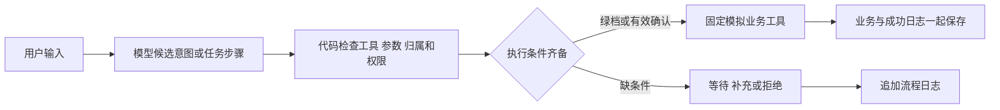

# 11 · 三场景模拟银行助手技术说明草稿

更新：2026-10-10。面向团队讲解及校内材料。依据当前v3权限、用户故事、`src/PUBLIC_API.md`及脱敏实际回执。DeepSeek本机密钥修正后，20:35开始的5次真实请求完成三方向模拟业务；20:39又完成两条真实模型依赖计划样例。独立63项业务测试通过，范围见[独立报告](09-independent-acceptance.md)，其离线替身结果不能代替真实服务和队友人工验收。本文保留正式缺项，不据此宣称正式达标。

## 一次请求怎样办理

模型像帮用户填写申请的助手，固定代码像按制度办事的柜台。模型听懂自然语言后提出候选意图和参数；代码核对身份、数据、权限、确认和执行条件；模拟工具办理；审计留下回执。用户和模型不能通过说“我已确认”或“这是绿色”改变代码规则。

本图说明职责。固定代码、模拟工具和真实模型已有分别记录的运行证据：[三方向真实回执](../evidence/real-model-integration.json)、[两条真实计划回执](../evidence/real-model-plans.json)与[独立业务测试](09-independent-acceptance.md)。图本身不能代替这些结果，也不能证明未测的复杂规划或正式要求。

## 三个场景与固定权限

| 场景 | 模型建议 | 固定代码办理 |
|---|---|---|
| 账单分析 | 本月、指定时间范围、候选账户 | 绿档；只读本人记录，以已发生账单计算实际支出 |
| 订阅 / 代扣管理 | 查询订阅或取消明确目标 | 黄档；先展示访问 / 修改范围，获得明确确认；取消仅变更模拟状态，保留历史账单 |
| 智能转账 | 本人转出账户、已登记联系人、金额 | 上海当日成功转出总额加本次不超过 1000.00 元为黄档；超过为红档，强验证或必要隔离未就绪则拒绝 |

当前固定业务白名单为 `query_balance`、`query_transactions`、`analyze_bills`、`query_subscriptions`、`cancel_subscription`、`transfer`。未知工具、额外字段、非法参数、越权直接拒绝。确认和取消是代码控制的流程事件，不增加业务工具。

## 金额、归属与事务

金额像数硬币一样以整数分计算。例如 9.90、19.90、29.90 元分别是 990、1990、2990 分，加起来是 5970 分。这样计算和数据库保存都不用小数近似值。金额必须是合法正整数分，零、负数、布尔值及超过两位小数的原始金额不能进入转账。

可信当前用户由本机入口或构造配置指定；聊天里的“我是张三”不改变身份。读记录及转出账户必须属于当前用户。代码允许的联系人可以收款到另一个模拟用户的账户，这不等于授予查询或扣除对方资金的权限。

事务像一次盖章：本次成功转账的扣款、收款、流水和成功日志要么一起保存，要么一起撤回。执行前在事务中重查余额、归属、上海自然日累计额、确认及重复请求。若生成确认后累计变化使请求升红，旧黄档确认不能放行。

## 确认与熔断

确认是一份有期限的具体申请，绑定用户、请求编号、意图、全部关键参数及五分钟有效期。用户取消、改金额、换目标、发起新请求或超时后，旧确认失效；已成功的请求只能消费一次。“嗯”“随便”不算同意，“不要执行”必须取消。

六位屏显码可用于确认同一份申请，不能证明持有独立手机。红档候选的密码加独立认证器尚无配置和验证证据，拒绝高风险动作是当前必须保持的行为。

熔断像短时锁住出错的柜台。代码按用户和操作类型保存连续失败次数，三次有效请求验证失败锁十分钟。换目标、换码、取消、重启都不能清零；完整验证成功或锁期到达后才按规则复位。具体通过证据须来自独立测试。

## 日志与模型边界

应用日志只能追加；查询、等待、拒绝、失败、取消、超时、锁定及成功均需记录。用户原话和参数脱敏，密码、模型密钥、认证秘密、有效验证码不能写入日志或模型上下文。成功业务与成功日志同事务；审计无法写入时停止后续业务。

本地数据库管理员仍能修改文件，所以不能宣称日志绝对不可篡改。关键词检查只是第一层；后面还要固定工具、类型、参数及归属检查。模型输出是数据，不能作为 Python、SQL 或 shell 执行。

## 公开接口与数据约定

独立测试通过 `src/PUBLIC_API.md` 的接口操作，不读取业务实现确定期望。主要入口是 `BankService.propose`、`confirm`、`cancel`、`handle_text`、`audit_events`、`close`，计划控制为 `resume_plan`、`interrupt_plan`、`takeover_plan`。启动命令及环境配置以 `src/README.md` 的实测说明为准。

测试夹具有 alice、bob 两名模拟用户；alice 主账户初始 10000.00 元、储蓄账户 5000.00 元，bob 主账户 1000.00 元。alice 本月三项已发生账单共 59.70 元；上月、失败、未来安排作为干扰数据，不计入本月到今天实际支出。订阅取消后，实际账单仍为 59.70 元，未来预计金额才会减少。

## 已有运行证据与缺项

主实现于北京时间2026-10-10 20:03用Python 3.12.14执行 `scripts/demo.py`，退出码0。脱敏结果保存于[three-scenario-demo.json](../evidence/three-scenario-demo.json)，模式明确标为离线候选演示，不是模型调用。以下离线数值来自该演示与独立报告，不将实现演示称为独立验收。

演示得到本月实际 `5970` 分；订阅查询先等待确认且无结果数据；取消视频会员后实际账单仍 `5970` 分、未来预计 `2980` 分；转 `10000` 分后 alice-main 为 `990000` 分、bob-main 为 `110000` 分，成功转账一条。重放、他人转出账户以及日累计 `110000` 分的红档申请均拒绝；重启读取仍保持转账后余额。独立最终63项通过，完整范围与未测项见docs/09。

真实模型集成于20:35:58开始运行 `scripts/live_demo.py`，5次实际请求得到代码回执，退出0。本月账单5970分；订阅查询和取消视频会员先pending，固定测试确认后success；取消后重查账单仍5970分；从alice-main向登记小王模拟转10000分，也先pending后固定测试确认成功。响应公开用量合计3526 token，只代表本次5次调用，不能当作全账户计量。测试脚本先核对预先指定的模拟用户、目标和金额，不能由此宣称生产自动授权或人工验收。

20:39:38开始执行 `scripts/live_plan_demo.py`，退出0。模型在两次自然语言请求中实际生成依赖步骤，合计1583 token。第一条“账单成功 → 订阅等待确认”经人工接管控制后订阅cancelled、旧确认rejected，保留账单5970分。第二条“查询主账户 → 模拟转账100元 → 再查余额”在转账前暂停，后置查询not_started；固定测试确认并续跑后得到主账户990000分。SQLite状态为alice-main990000、alice-savings500000、bob-main110000，一条转账；重复旧确认拒绝。

这些是真实模型提出两条指定依赖计划并由代码办理的证据，不证明任意复杂图均可规划。每个黄档节点仍要独立授权，不能由模型或计划替代确认。计划保存在会话内存，重启不能恢复旧授权。

事务回滚只撤销未提交修改；已提交转账不自动反转，已取消订阅没有恢复白名单工具，完整补偿回退尚未实现。接管控制接口能停止未完成步骤并显示状态，不能称为完整人工补救流程。

本机Docker客户端可调用，但引擎连接失败；没有容器边界实验，详见[可行性证据](10-feasibility-evidence.md)。早先受限网络调用失败、联网请求HTTP401认证失败已分别保存在[network-failure](../evidence/real-model-network-failure.json)和[auth-failure](../evidence/real-model-auth-failure.json)；修正本机密钥后真实成功不覆盖失败历史。离线候选与测试替身仍不能写成真实模型证据。

真实模型的两条依赖计划样例已测；正式复杂任务规划、完整中断 / 回退 / 人工补救流程、真实多因素认证、受限监控环境、正式APP / IM渠道及队友人工验收仍需各自证据。串行重放与执行前状态变化已测，实际并发压力、断电提交及完整资源边界未证实。后续按实际结果更新，不预填“正式达标”。
