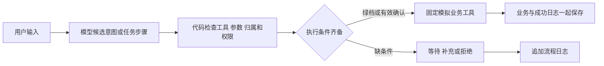

# 11 · 三场景模拟银行助手技术说明草稿

**2026-10-28六场景当前实现**：新模块`SixScenarioMixin`复用原代码权限/确认/SQLite事务；`six_calculator`计算固定授权快照并随worker/监督者纳入只读Docker指纹；`six_conversation`逐字段核对人类来源。预算占用可用余额，订单同事务写现金/预算/费用/请求/计划/审计，和转账统一累计/失败锁。恢复先核对同意再新节点确认；仅静态已有目标，不自动补偿。实际覆盖、版本比较、真实用量、网页与缺项详见[41](41-six-delivery.md)，下方为旧三方向草稿。

**2026-10-25六场景扩展**：当前工程目标已升级，v4接口及数据不变量见[src/SIX_SCENARIO_API.md](../src/SIX_SCENARIO_API.md)，范围见[36](36-six-scenario-scope.md)。沿用Python标准库、SQLite及原权限/确认/持久计划控制器，新增固定产品比较/匹配、卡状态、预算占用和订单；Docker仍只计算授权快照，宿主固定SQL同事务保存业务、请求、节点和审计。预算保留减少可用余额，支付消耗现金与预算并形成实际账单；订单和转账共用上海日累计。当前实施/验收状态以新最终报告为准，下文三场景数字保留为历史，不冒称六方向已测。

更新：2026-10-11。面向团队讲解及校内材料，依据v3权限、用户故事、公开契约与脱敏证据。已实现本机Web及CLI，真实正常5请求、两条依赖计划及6条异常各有证据，异常已独立审核。独立离线66业务＋27 HTTP共93项通过，11.702s、退出0；主实现桌面QA通过覆盖的三场景、确认 / 拒绝、审计和账本核对。计划GUI控制未计通过，移动端按用户要求待云端后再测、不计通过或失败。模拟身份和阶段证据不代表生产认证、队友人工验收或正式达标。

## 接管后的MFA与回归证据

密码加独立手机认证器的模块已通过[43项、99子用例独立合成验收](23-mfa-independent-acceptance.md)。代码登记先验证手机码持有证明；红档需要对展示操作明确同意，因素验证不能授权另一请求。动态码不落库，已用时间步与三错锁定持久化；提交前过期、审计故障均回滚认证元数据。因素只在本机交互入口输入，普通聊天和审计做有明确范围的已知秘密误贴防护。规则与限制见[22](22-mfa-strong-verification.md)，不声称能识别任意混杂或编码的口令。

这仍是合成因素和模拟银行数据。真人登记、独立手机持有与真实终端无回显未验；受限隔离未实测，正确因素只得到`passed`及`rejected/isolation_unavailable`，无红档转账。当前[统一141项回归](../evidence/combined-regression-20261011-154218-477873.txt)通过、87.947秒、退出0，原93报告保留，不能合并说成141次真实模型请求。

## 一次请求怎样办理

模型像帮用户填写申请的助手，固定代码像按制度办事的柜台。模型听懂自然语言后提出候选意图和参数；代码核对身份、数据、权限、确认和执行条件；模拟工具办理；审计留下回执。用户和模型不能通过说“我已确认”或“这是绿色”改变代码规则。

本图说明职责。实际证据分别为[最新三方向集成](../evidence/real-model-integration.json)、[两条真实计划回执](../evidence/real-model-plans.json)与[独立离线业务测试](09-independent-acceptance.md)。图本身不能代替运行结果，也不能证明未测的复杂规划或正式要求。

## 本机浏览器怎样接入

浏览器像柜台窗口，后端仍由同一套 `BankService` 办理。标准库HTTPServer只监听127.0.0.1，提供三份固定HTML/CSS/JS资源；页面提交自然语言或固定确认 / 取消 / 计划 / 审计请求，不提交任意业务候选。密钥留在后端，网页不能切换可信用户；默认alice是预置模拟身份，没有真实登录系统。

页面示例只填输入，发送和确认分别由用户触发。黄档回执先显示用户、目标、金额、影响和期限；屏显码只保留页面内存，不进模型、日志或浏览器存储。模型及外部文字按普通文本渲染。后端检查同源、会话令牌、JSON格式和字段，固定资源不开放任意文件，详细见[HTTP契约](../src/WEB_API.md)。这些限制是本机入口防护，不是MFA或受限沙箱；HTTP离线测试和浏览器真实点击分别留证。

## 三个场景与固定权限

| 场景 | 模型建议 | 固定代码办理 |
|---|---|---|
| 账单分析 | 本月、指定时间范围、候选账户 | 绿档；只读本人记录，以已发生账单计算实际支出 |
| 订阅 / 代扣管理 | 查询订阅或取消明确目标 | 黄档；先展示访问 / 修改范围，获得明确确认；取消仅变更模拟状态，保留历史账单 |
| 智能转账 | 本人转出账户、已登记联系人、金额 | 上海当日成功转出总额加本次不超过 1000.00 元为黄档；超过为红档，强验证或必要隔离未就绪则拒绝 |

当前固定业务白名单为 `query_balance`、`query_transactions`、`analyze_bills`、`query_subscriptions`、`cancel_subscription`、`transfer`。未知工具、额外字段、非法参数、越权直接拒绝。确认和取消是代码控制的流程事件，不增加业务工具。

## 金额、归属与事务

金额像数硬币一样以整数分计算。例如 9.90、19.90、29.90 元分别是 990、1990、2990 分，加起来是 5970 分。这样计算和数据库保存都不用小数近似值。金额必须是合法正整数分，零、负数、布尔值及超过两位小数的原始金额不能进入转账。

可信当前用户由本机入口或构造配置指定；聊天里的“我是张三”不改变身份。读记录及转出账户必须属于当前用户。代码允许的联系人可以收款到另一个模拟用户的账户，这不等于授予查询或扣除对方资金的权限。

事务像一次盖章：本次成功转账的扣款、收款、流水和成功日志要么一起保存，要么一起撤回。执行前在事务中重查余额、归属、上海自然日累计额、确认及重复请求。若生成确认后累计变化使请求升红，旧黄档确认不能放行。

## 确认与熔断

确认是一份有期限的具体申请，绑定用户、请求编号、意图、全部关键参数及五分钟有效期。用户取消、改金额、换目标、发起新请求或超时后，旧确认失效；已成功的请求只能消费一次。“嗯”“随便”不算同意，“不要执行”必须取消。

六位屏显码可用于确认同一份申请，不能证明持有独立手机。密码加独立认证器模块已通过43项/99子用例合成验收；真人密码登记、独立手机与真实终端尚无实测证据，必要隔离也未实测，红档继续拒绝。

熔断像短时锁住出错的柜台。代码按用户和操作类型保存连续失败次数，三次有效请求验证失败锁十分钟。换目标、换码、取消、重启都不能清零；完整验证成功或锁期到达后才按规则复位。具体通过证据须来自独立测试。

## 日志与模型边界

应用日志只能追加；查询、等待、拒绝、失败、取消、超时、锁定及成功均需记录。用户原话和参数脱敏，密码、模型密钥、认证秘密、有效验证码不能写入日志或模型上下文。成功业务与成功日志同事务；审计无法写入时停止后续业务。

本地数据库管理员仍能修改文件，所以不能宣称日志绝对不可篡改。关键词检查只是第一层；后面还要固定工具、类型、参数及归属检查。模型输出是数据，不能作为 Python、SQL 或 shell 执行。

## 公开接口与数据约定

独立测试通过 `src/PUBLIC_API.md` 的接口操作，不读取业务实现确定期望。主要入口是 `BankService.propose`、`confirm`、`cancel`、`handle_text`、`audit_events`、`close`，计划控制为 `resume_plan`、`interrupt_plan`、`takeover_plan`。启动命令及环境配置以 `src/README.md` 的实测说明为准。

测试夹具有 alice、bob 两名模拟用户；alice 主账户初始 10000.00 元、储蓄账户 5000.00 元，bob 主账户 1000.00 元。alice 本月三项已发生账单共 59.70 元；上月、失败、未来安排作为干扰数据，不计入本月到今天实际支出。订阅取消后，实际账单仍为 59.70 元，未来预计金额才会减少。

当前账单统计口径也计入成功的模拟转出，所以同库转100元后再次分析会得到159.70元，不能继续沿用初始59.70元。展示两个计划样例时各用新的演示库，才能复现原计划回执里的初始金额。

## 已有运行证据与缺项

主实现于北京时间2026-10-10 20:03用Python 3.12.14执行 `scripts/demo.py`，退出码0。脱敏结果保存于[three-scenario-demo.json](../evidence/three-scenario-demo.json)，模式明确标为离线候选演示，不是模型调用。以下离线数值来自该演示与独立报告，不将实现演示称为独立验收。

演示得到本月实际 `5970` 分；订阅查询先等待确认且无结果数据；取消视频会员后实际账单仍 `5970` 分、未来预计 `2980` 分；转 `10000` 分后alice-main `990000` 分、bob-main `110000` 分，成功转账一条。重放、他人转出账户和日累计 `110000` 分的红档申请均拒绝，重启保持余额。独立离线66业务＋27 HTTP统一93项通过，完整范围与未测项见[报告](09-independent-acceptance.md)。

首次真实集成于2026-10-10 20:35:58开始，5次请求完成账单5970分、订阅查询、取消视频会员、历史重查仍5970分以及模拟转账10000分，退出0。黄档都先pending，再核对预先指定的模拟用户、目标和金额后调用固定测试确认；这不能宣称生产自动授权或人工验收。

2026-10-10 20:41:13加入SQLite状态断言后复跑，第三条“请取消我的视频会员”被误判clarification，脚本失败并停止后续检查。[误判回执](../evidence/real-model-clarification-failure.json)保留：所有余额、订阅、历史交易及转账表的前后快照一致，拒绝后没有误改业务。20:36另有[启动脚本账单查询](../evidence/start-natural.json)成功证据。

修正提示后，2026-10-11 10:14:36开始的[当前集成检查](../evidence/real-model-integration.json)5请求退出0。账单5970分；订阅查询、取消视频会员和转10000分均先pending，经固定测试确认后success；取消后历史仍5970分。SQLite复查仅sub-video取消，未来预计2980分；余额990000 / 500000 / 110000分、一条成功转账，原7条历史交易逐行保持并新增双方2条流水。公开响应用量3960 token仅覆盖5个响应；未来预计由代码读账本复查，没有额外第六次模型调用。测试确认不代表生产自动授权，CLI单次调用也不能补成全账户计量。

10:23:54另执行6条独立设计的真实异常用例，退出0，最终[独立审核](13-real-model-acceptance.md)通过。5条取得真实JSON返回、4007 token，1条明显注入由输入层阻断、没有模型调用；否定取消、归属、精确红档金额、缺失联系人及不存在订阅各有候选 / 响应、SQLite与审计证据。原始JSON保留运行时待审核标记，以独立报告的审核结论为准。首轮发现不存在订阅的拒绝审计缺失目标，保留[问题回执](../evidence/real-model-acceptance-before-audit-fix.json)，修复后新增3项离线独立审计回归并复跑真实用例。单例通过不证明全面攻击防御。

本机HTTP首轮27项中25通过、2失败，问题是缺失JS资源及未知POST路径的状态码；[历史输出](../evidence/independent-web-acceptance.txt)保留。修复后原样27项通过，最终与66业务统一93项11.702s通过。HTTP使用离线模型替身，核对来源 / 字段拒绝、确认重放、双方流水、审计和秘密保护；不能由它证明真实浏览器DOM、点击或窄屏布局。

[主实现桌面QA](../evidence/browser-ui-validation.json)在独立库与8766端口取得真实页面结果：账单59.70元；订阅先pending，用户点击确认后三条；根代理取消视频并复查历史59.70元、未来29.80元；转100元前显示完整目标、金额和日累计，SQLite原余额且无转账，点击确认后页面成功100元、本人余额9900 / 5000元；累计1100元红档拒绝。该红档请求的实际输入重复了一次1000元句子，模型仍给100000分候选，原输入保留。SQLite最终余额990000 / 500000 / 110000分、视频取消、未来2980分、9条交易和一笔10000分转账，红档拒绝审计存在。

审计打开 / 展开 / 关闭、最新JS重载后的订阅确认通过；两次控制台错误 / 警告查询均为空。桌面实际1536×1024、scrollWidth1536，临时视口已恢复；手机按用户要求待云端后再测。浏览器用量没有导出，不能与脚本用量混算。另看到GUI账单→订阅图，账单159.70元、订阅等待后显示中断；触发主体未单独核对，未把它计为根代理计划控制按钮通过。桌面QA不是队友人工全量验收。

20:39:38开始执行 `scripts/live_plan_demo.py`，退出0。模型在两次自然语言请求中实际生成依赖步骤，合计1583 token。第一条“账单成功 → 订阅等待确认”经人工接管控制后订阅cancelled、旧确认rejected，保留账单5970分。第二条“查询主账户 → 模拟转账100元 → 再查余额”在转账前暂停，后置查询not_started；固定测试确认并续跑后得到主账户990000分。SQLite状态为alice-main990000、alice-savings500000、bob-main110000，一条转账；重复旧确认拒绝。

这些是真实模型提出两条指定依赖计划并由代码办理的证据，不证明任意复杂图均可规划。每个黄档节点仍要独立授权，不能由模型或计划替代确认。计划保存在会话内存，重启不能恢复旧授权。

事务回滚只撤销未提交修改；已提交转账不自动反转，已取消订阅没有恢复白名单工具，完整补偿回退尚未实现。接管控制接口能停止未完成步骤并显示状态，不能称为完整人工补救流程。

本机Docker客户端可调用，但引擎连接失败；没有容器边界实验，详见[可行性证据](10-feasibility-evidence.md)。早先受限网络调用失败、联网请求HTTP401认证失败已分别保存在[network-failure](../evidence/real-model-network-failure.json)和[auth-failure](../evidence/real-model-auth-failure.json)；修正本机密钥后真实成功不覆盖失败历史。离线候选与测试替身仍不能写成真实模型证据。

桌面QA、两条真实脚本计划及27项HTTP各有覆盖范围；计划GUI控制未计通过，移动端按用户要求待云端后再测。正式复杂规划、完整回退 / 人工补救、真人MFA、受限监控环境、正式APP / IM渠道及完整人工记录仍需证据。并发日累计已有实现侧线程专项及[独立双进程10轮](20-v2-process-independent-acceptance.md)，最高99000分未超限；不证明全部交错和极端锁超时。V1字段专项及[独立4项](16-v1-independent-acceptance.md)通过，七项工程口径见[18](18-v1-disclosure-policy.md)，完整自然语言归纳补测仍缺。断电提交和完整资源边界未证实；当前旧快照不代替19—20点技术收尾与新包。
