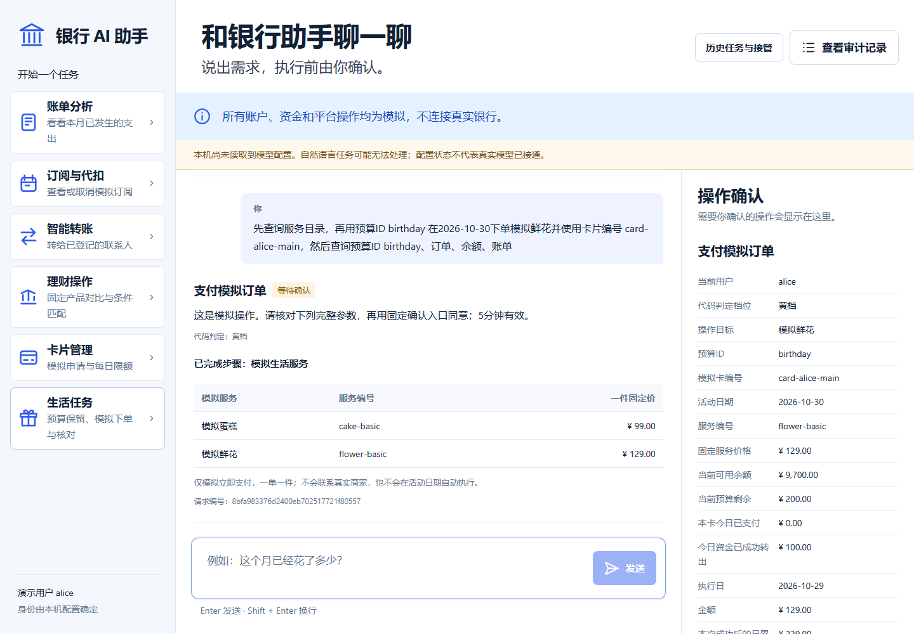
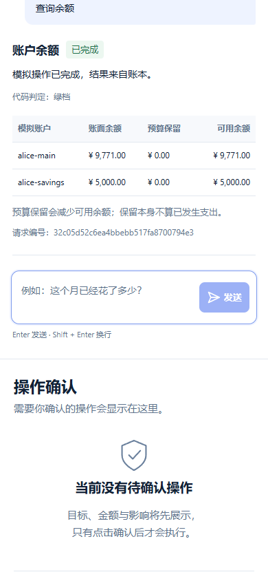

# 41 · 六场景交付与验证

2026-10-28。按队长的`task2/未命名 15.md`，在原三场景及task1～3成果上完成六方向范围内的实际实现。全部账户、理财产品、卡、服务、资金与订单都是模拟；没有公开仓库、push、部署或联系真实商户。完整范围见[36](36-six-scenario-scope.md)，固定规则及表字段见[公开契约](../src/SIX_SCENARIO_API.md)，逐方向输入、确认与手算见[38](38-six-reproduce.md)。

最终源码/测试指纹：`05f3035fed4463db211b6d2a9361fcae2d3af09d2b84854e5a1efb5381044f77`。版本比较与测试期望保护见[版本证明](../evidence/six-version-proof-20261028-171951-427599.json)。源码包文件为`dist/fintechathon-six-scenarios-20261028.zip`，内含`PACKAGE_MANIFEST.json`逐文件SHA256、完整源码/测试指纹；密钥、数据库、临时目录、机器专用Docker配置及旧ZIP不入包。ZIP自身SHA、解包回归及最后保护核对在打包后生成的包外`six-package-check-*.json`和`six-delivery-*.json`中提供，不能把打包前运行冒称解包运行。

## 实际能力与资金约束

| 方向 | 已实现的核心能力 | 关键实际变化/边界 |
|---|---|---|
| 转账 | 明确联系人/金额、缺项澄清、固定确认、双方余额与流水 | 预算剩余真实占用可用余额；跨本人账户与订单统一上海日累计；五分钟内跨日按新日复检 |
| 账单 | 真实模拟流水、日期区间、分类、实际与未来分离 | 订单费用进入实际账单；预算保留/释放不是消费，不双计 |
| 订阅 | 原查询及取消、各自黄档确认 | 取消只改本人状态与未来预计，不删历史、不退款 |
| 理财 | 四产品固定数据、指定顺序比较、风险/期限/流动性三条件匹配 | 匹配不放宽条件，允许空结果；展示年化为假设数据，不保证真实收益 |
| 卡片 | 本人查询、黄档申请非支付虚拟卡、黄档真实修改限额 | 显式选卡订单受本卡日限额实际约束；不选卡不擅选，不增加余额/授信 |
| 生活任务 | 明确日期/预算保留、固定价鲜花/蛋糕、确认付款、预算/订单/余额/账单核对 | 先保留已有预算，再静态依赖组合；取消不退款或自动释放，释放剩余另经黄档确认 |

22项固定工具仍由代码判权限、归属、参数和执行。转账与已付订单跨账户合计不超过100000分为黄档，超过红档拒绝；二者共享持久失败计数，三错锁十分钟，换工具/重启不清零。预算恒等式为原始额=剩余+已付+已释放。业务、请求、计划节点和成功审计同事务；故障回滚、不做部分成功。新增工具在显式Docker模式中没有普通执行回退。

生活任务手算：全新库主账户1000000分，保留20000分后可用980000；鲜花12900分付款后账面987100、剩余7100、已付12900、可用仍980000、本月实际18870。再买9900分蛋糕因预算不足拒绝；另确认释放7100后可用987100，已付订单与实际18870保持。网页综合流程还先转出10000分，因此其终态主账户977100、实际28870，不能混用两组初始条件。

## 独立、真实及网页证据

独立作者未读业务实现，先冻结范围和[52项矩阵](37-six-independent-matrix.md)，首跑后分别判读脚手架和业务问题。[独立报告40](40-six-independent-acceptance.md)保留输入、期望、实际、是否运行、核对方法和不确定处。

| 运行 | 实际结果与证据 |
|---|---|
| 新专项首轮52 | 1失败/49错误，未记通过：[原始](../evidence/six-independent-run-20261028-003626-968617.txt)。Windows辅助SQL连接未显式关闭造成49清理错误；明确“买服务”未识别造成S44业务失败 |
| 修后52及原45 | 两组测试本身exit0，业务断言均通过，原始[52](../evidence/six-independent-run-20261028-165300-526411.txt)/[45](../evidence/six-context-run-20261028-165301-123859.json)保留；期间新增独立真实runner，整树保护包装器因源变化仍为false，不冒称最终整树通过 |
| 原恢复37 | [37项通过](../evidence/six-recovery-run-20261028-003654-481266.json)，无源码/保护变化 |
| 原159首回归 | [1项跨日兼容失败](../evidence/isolation-regression-20261028-083657-591554.txt)保留；旧非法金额及跨日行为按原断言修复，没有改原业务断言 |
| 真实Docker独立33 | [33项通过](../evidence/docker-isolation-run-20261028-165949-501172.json)，无fail/error/skip，源码和日常文件摘要均未变；新worker、监督者、纯计算模块及隔离后端在最终版本保持相同指纹 |
| 真实模型首批 | [1～7组通过，8失败，9未达](../evidence/six-live-run-20261028-165953-422354.json)：21次调用/42277 tokens；明确订单被模型标unsupported，未到卡限额，不能用此拒绝充当验证通过 |
| 修提示第二批 | [8通过，9准备阶段失败](../evidence/six-live-run-20261028-171541-238824.json)：7次/17024 tokens。8实际核对卡限额与跨账户统一累计；9候选完全正确，runner漏掉公开默认日期规范化，未付款 |
| 窄修脚手架第三批 | [9全链通过](../evidence/six-live-run-20261028-171955-229821.json)：2次/5037 tokens；真实子进程退出后重开，旧码失效，恢复同意不付款，新请求确认付款一次，计划/费用/审计与Docker回执对应 |
| 最终网页 | [三轮记录及最后通过](../evidence/six-ui-validation-20261028-172316-862429.json)。首轮helper误点已自动关闭的历史窗；修helper后通过，截图复核再将对象JSON改为中文金额分组，最终版本再次完整通过 |

三批累计30次进入适配器、30次本地传输尝试，服务报告64338 tokens（prompt与completion逐次记录），费用unknown；没有自动重试、换模型或增加调用。九组是在保留失败后分批覆盖完成，不是一次同版本九组全过。请求alias及服务返回标签为deepseek-flash，不等于不可变模型权重版本。最终L9与源码包指纹一致；先前各组版本差异明确记录，业务权限未因提示修正放宽。完整安全候选、代码响应、资金、监控和用量保存在各`six-live-*`目录events.jsonl/report.json，SQLite夹具不入源码包。

52项全部测试方法、输入和断言修订前后AST一致；只修SQL辅助关闭。真实runner仅将bill持久快照按原公开契约精确核对月初/固定当日，input_params仍须{}，不改原人类输入、候选计划、其他节点、依赖、确认或资金断言。原测试/runner及提示修前源码副本作为安全txt留在evidence，版本证明不替代实际复测。

## 网页QA

沿用前端测试技能；Browser插件/对应技能未提供，使用已有Playwright和Chrome，无新增安装。最终临时URL为`http://127.0.0.1:62077`，验收后已停止；它不是日常网站。桌面1440×1000、移动390×844，移动尺寸不等于真人手机。模型是精确短语离线替身，候选解析和业务工具均真实经过独立Docker；真实模型证据另列。

| 检查 | 最终结果 |
|---|---|
| 页面身份、非空、无框架错误层 | 通过 |
| 控制台与页面异常 | 0相关错误/警告；仅favicon缺失单列，不算业务错误 |
| 六入口、示例只填不发送、真实结果表 | 通过 |
| 历史核对→恢复同意→继续→新黄档确认 | 通过，同意恢复本身不改卡或资金 |
| 预算→固定确认订单→依赖核对→移动释放 | 通过，余额/预算/订单/账单/审计一致 |
| 外部文字、安全纯文本及移动宽度 | 通过，注入标记未成为img/svg/script，页面无横向溢出 |
| 截图 | 10张最终图，屏显码隐藏；两张已复核图随包提供 |

最终网页17个阶段通过，54个Docker成功finished，均回收。原转账一次、订单一次、新卡一次、预算保留/释放各一次；限额修改两次（历史恢复和本轮新设置）。最终主账户977100分、小王110000、订单12900、预算已付12900/释放7100/剩余0、本月实际28870、未来3980。第一轮失败报告及原始截图仍保留，不通过改断言掩盖。

## 可复现与未完成项

按[38](38-six-reproduce.md)启动、逐方向运行；隔离模式必须明确选择含3份固定代码的新runtime。解包校验入口：

```powershell
python scripts/six_package_check.py --archive dist/fintechathon-six-scenarios-20261028.zip --runtime .isolation/docker-runtime-six-live-20261028
```

该入口核对CRC/逐文件/内容与源码指纹、安全路径、与受测runtime的三文件一致，然后在解包树分别运行原159、对话45、恢复37、新52（其中S50实际Docker），最后用公开启动脚本两次重启核对独立模拟库已提交业务和持久锁。结果与ZIP SHA在包外新报告保存，不覆盖旧包或旧证据。

未支持后台定时、自动商户联络、真实支付凭据、真实银行/商户、动态结果引用、成功业务自动补偿或银行员工处置。理财申购/赎回、卡挂失/解挂与超阈值资金红档继续拒绝。Windows LPAC失败及Docker覆盖限制沿用task1报告；有限输入不证明任意中文可靠。真人MFA手机/终端、两位队友人工、校内通知与正式赛事渠道认可继续待本人/实际通知，不替填通过，按队长2026-11-02安排推进。

## 已复核截图



